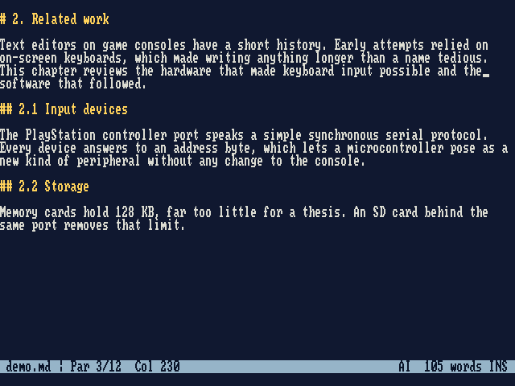
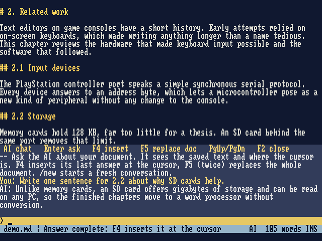

# ps1-writer

Some of the code is written or supported by AI; use it at your own risk.

[](https://youtu.be/5wookCM2O7A)]([https://www.youtube.com/watch?v=VIDEO_ID](https://youtu.be/5wookCM2O7A))

A text editor for the original PlayStation, made for writing long documents such as a thesis. You type on an ordinary **USB keyboard** and documents are stored on an **SD card**. A Raspberry Pi Pico 2 on **controller port 2** handles both. An optional **AI assistant** on a PC can read the document and write into it.

```
USB keyboard ──> Pico 2 ──> controller port 2 ──> PS1: editor, 80 columns
SD card      <──>  (UTF-8 .md / .txt files you can open on any PC)
PC (USB)     <──>  pc/ai_bridge.py ──> Claude, a local model, or any OpenAI-compatible API
```



## Features

- 80-column text screen; 20–30 rows to fit any TV (F11/F12)
- Documents up to 1 MB with word wrap, find, and headings for lines starting with `#`
- Saves only what changed, checks every save, and keeps the last 5 versions
- Autosave, and you can keep typing while the card is written
- AI chat (F2): ask about the document, insert or replace text with the answer



## Quick start

Ready-built files are on the **Releases** page.

1. **Wire it up**: controller port 2, a USB-A socket and an SD card to the Pico. See [docs/hardware.md](docs/hardware.md) for pins and safety notes. Never connect the port's 7.6 V or 3.5 V pins.
2. **Flash the Pico**: hold BOOTSEL, plug it into USB and copy `ps1_writer.uf2` to the drive that appears.
3. **Burn the disc**: write `ps1writer_250k.cue` to a CD-R at the slowest speed. The console must be able to boot burned discs.
4. **Start**: power the Pico, plug in the keyboard *after* the Pico has started, then switch on the console.

Not every keyboard works yet; `kbtest.uf2` checks yours (see [hardware](docs/hardware.md#keyboard-test)).

## Keys

| Key | Action |
|---|---|
| Ctrl+S | save (also automatic) |
| Ctrl+O / Ctrl+N | open / new document |
| Ctrl+F, F3 | find, find next |
| Ctrl + arrows | move by word / paragraph |
| Insert | insert / overwrite |
| F1 | help |
| F2 | AI chat; F4 inserts the answer, F5 twice replaces the document |
| F11 / F12 | fewer / more screen rows |

Documents live in `/ps1writer/` on the card as plain UTF-8, so you can edit them on a PC too. Characters outside Latin-1 are replaced with the nearest match (ş → s, “ → ").

## AI chat

```
pip install pyserial
python3 pc/ai_bridge.py --backend claude-code     # or anthropic, openai (local models), echo
```

The whole document is sent with each question. Setup, privacy and cost: [docs/ai-chat.md](docs/ai-chat.md).

## Limitations

No undo, no copy and paste, Latin-1 text only, US keyboard layout only.

## Documentation

- [docs/hardware.md](docs/hardware.md): wiring, keyboard test, disc speeds
- [docs/ai-chat.md](docs/ai-chat.md): AI backends and usage
- [docs/development.md](docs/development.md): building, tests, how saving works
- [docs/technical-reference.pdf](docs/technical-reference.pdf): bus protocol and Pico porting guide

## Credits

[PSn00bSDK](https://github.com/Lameguy64/PSn00bSDK), [Pico SDK](https://github.com/raspberrypi/pico-sdk), [TinyUSB](https://github.com/hathach/tinyusb), [Pico-PIO-USB](https://github.com/sekigon-gonnoc/Pico-PIO-USB), [no-OS-FatFS-SD-SDIO-SPI-RPi-Pico](https://github.com/carlk3/no-OS-FatFS-SD-SDIO-SPI-RPi-Pico), [font8x8](https://github.com/dhepper/font8x8) (public domain) and [psx-spx](https://psx-spx.consoledev.net/). The libraries in `pico/lib/` are git submodules and keep their own licences.
